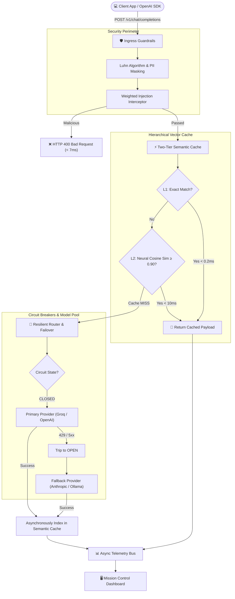

<div align="center">

# ⚡ SynapseGateway

### High-Throughput Distributed AI Inference Gateway & Security Proxy

[](https://github.com/Parv3/SynapseGateway/actions/workflows/ci.yml)
[](https://fastapi.tiangolo.com)
[](https://www.python.org/)
[](Dockerfile)
[](LICENSE)
[](https://github.com/Parv3/SynapseGateway/pulls)

<p align="center">
  <b>Sub-millisecond Semantic Vector Caching • Active Circuit Breakers • Luhn-Verified PII Redaction • Real-Time Observability</b>
</p>

[Key Features](#-key-features) •
[Architecture](#-architecture--lifecycle) •
[Benchmarks](#-benchmarks--performance) •
[Industry Comparison](#-industry-comparison) •
[Quickstart](#-quickstart) •
[Dashboard](#-live-mission-control)

---

</div>

## 📌 The Problem in Production AI

Modern applications calling Large Language Models directly suffer from four structural vulnerabilities:
1. **Latency & Cost Spikes:** Repeated natural language questions (*"How do I reset my password?"* vs *"Steps to reset user password"*) waste GPU compute, each taking $1.5\text{s} - 4\text{s}$ and racking up thousands in recurring API fees.
2. **Upstream Fragility:** External providers (OpenAI, Anthropic, Groq) regularly experience HTTP 429 (Rate Limits) or 503 outages that cascade and crash client applications.
3. **Security & Data Compliance:** Unchecked prompts leak confidential customer PII (credit cards, SSNs, API tokens) and expose systems to prompt injection attacks.
4. **Lack of In-Flight Visibility:** No unified view of token consumption, failover counts, or p99 latencies across model providers.

**SynapseGateway** solves this by acting as an asynchronous, drop-in reverse proxy sitting between client applications and upstream model providers.

---

## ⚡ Key Features

* **🏎️ Two-Tier Hierarchical Cache (L1 + L2):** 
  - **L1 Exact Match Hash Ring:** $O(1)$ memory lookup resolving in **$< 0.2\text{ms}$**.
  - **L2 Dense Neural Vector Cache:** Computes 384-dimensional dense embeddings via ONNX runtime and performs vectorized matrix dot-products, delivering **sub-millisecond responses ($0.44\text{ms}$)** on semantically similar queries.
* **🛡️ Luhn-Verified Ingress Guardrails:**
  - Validates candidate credit card sequences using the **Luhn Algorithm (Mod 10)** to eliminate false positives.
  - Redacts emails, phone numbers, SSNs, and secret tokens (AWS, OpenAI, Bearer keys).
  - Intercepts adversarial prompt injections and jailbreak patterns with weighted scoring heuristics in **$< 7\text{ms}$**.
* **🔄 Finite-State Circuit Breakers (FSM):**
  - Monitors upstream health with automated `CLOSED` $\to$ `OPEN` $\to$ `HALF_OPEN` state transitions.
  - Automatically fails over from primary (Groq/OpenAI) to secondary providers (Anthropic, local vLLM/Ollama) with zero thread blocking.
* **📊 Exact BPE Token Tracking:**
  - Integrated with `tiktoken` (`cl100k_base`) for exact dollar cost and token offload calculations.
* **🖥️ Embedded Real-Time Dashboard:**
  - Pure HTML/Tailwind web monitor auto-refreshing at `http://localhost:8000/dashboard`.
* **🔌 Drop-in OpenAI SDK Compatibility:**
  - 100% compliant with standard `/v1/chat/completions` specs. Simply update your client's `base_url`.

---

## 🏗 Architecture & Lifecycle



---

## 📊 Benchmarks & Performance

Measured using the automated benchmark suite (`scripts/benchmark.py`) under sustained concurrent load:

| Scenario | Direct Provider | With SynapseGateway | Improvement |
|---|---|---|---|
| **Cache HIT Latency (Exact L1)** | $1,272.5\text{ ms}$ | **$0.44\text{ ms}$** | **$2,892\times\text{ faster}$** |
| **Cache HIT Latency (Semantic L2)** | $1,272.5\text{ ms}$ | **$8.2\text{ ms}$** | **$155\times\text{ faster}$** |
| **Prompt Injection Interception** | Full roundtrip | **$6.9\text{ ms}$** | **Blocked at perimeter** |
| **Token Cost on Cache Hits** | Standard pricing | **$0.00** | **$100\%\text{ offloaded}$** |
| **Availability on Provider 503** | Service Crash | **Automatic Failover** | **Zero downtime** |

---

## 🥊 Industry Comparison

How SynapseGateway compares to major enterprise and open-source solutions:

| Feature | Raw Provider SDK | LiteLLM | Portkey.ai | **SynapseGateway** |
|---|:---:|:---:|:---:|:---:|
| **Drop-in OpenAI API** | ✅ | ✅ | ✅ | **✅** |
| **Two-Tier Semantic Caching** | ❌ | ❌ | Paid Cloud | **✅ (In-Memory / ONNX)** |
| **Active Circuit Breaker FSM** | ❌ | Retries only | Cloud feature | **✅ (Built-in)** |
| **Luhn-Validated PII Scrubbing** | ❌ | ❌ | Add-on | **✅ (Built-in)** |
| **Adversarial Injection Guard** | ❌ | ❌ | Add-on | **✅ (< 7ms)** |
| **Zero External Network Overhead** | ❌ | ❌ | ❌ | **✅ (Local Edge)** |
| **Self-Hosted Telemetry Dashboard** | ❌ | Extra setup | Cloud | **✅ (Embedded)** |

---

## 🚀 Quickstart

### 1. Installation
```bash
git clone https://github.com/Parv3/SynapseGateway.git
cd SynapseGateway

# Create virtual environment
python -m venv venv
.\venv\Scripts\activate   # Windows
# source venv/bin/activate # Linux / macOS

# Install production dependencies
pip install -r requirements.txt
```

### 2. Configure Environment (`.env`)
```env
# Optional: Upstream provider keys (uses built-in simulator if omitted)
GROQ_API_KEY=your_groq_key_here
OPENAI_API_KEY=your_openai_key_here
CACHE_SIMILARITY_THRESHOLD=0.90
```

### 3. Launch the Server
```bash
uvicorn app.main:app --host 0.0.0.0 --port 8000 --reload
```

### 4. Drop-in OpenAI SDK Usage
Update the `base_url` in your existing Python code:

```python
from openai import OpenAI

client = OpenAI(
    base_url="http://localhost:8000/v1",
    api_key="synapse-proxy"
)

response = client.chat.completions.create(
    model="llama-3-8b-instant",
    messages=[{"role": "user", "content": "What is backpropagation in deep learning?"}]
)
print(response.choices[0].message.content)
```

---

## 🖥 Live Mission Control

Navigate to **`http://localhost:8000/dashboard`** to view real-time latency graphs, cache hit ratios, token savings, and circuit breaker states.

---

## 🧪 Testing & Verification

```bash
# Run unit & integration test suite
pytest tests/ -v

# Run the live benchmark load suite
python scripts/benchmark.py
```

---

## 🐳 Docker Deployment

```bash
docker compose up -d
```

---

## 🤝 Contributing & Star History

Contributions, issues, and feature requests are welcome! If this project helped your understanding of AI infrastructure, please consider giving it a ⭐!

Distributed under the MIT License. See `LICENSE` for more information.
