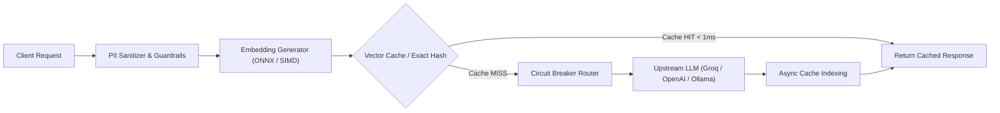

# SynapseGateway

An asynchronous, drop-in AI inference gateway that sits between client applications and upstream LLM providers. It brings two-tier semantic vector caching, multi-tenant isolation, active circuit breakers, and inline data sanitization into a single lightweight service.

[](https://github.com/Parv3/SynapseGateway/actions/workflows/ci.yml)
[](https://fastapi.tiangolo.com)
[](https://www.python.org/)
[](LICENSE)

---

## Why this exists

When running LLMs in production, calling provider APIs directly introduces four operational bottlenecks:

1. **High latency on repetitive traffic:** Natural language queries often express identical intent in different words (*"How do I reset my password?"* vs *"Steps to reset user password"*). Naive string caches miss these queries, forcing roundtrips that take 1.5 to 4 seconds and consume billable tokens each time.
2. **Provider instability:** Upstream rate limits (HTTP 429) and outages (HTTP 503) cascade directly into client applications unless there is automated, circuit-breaking failover.
3. **Data leakage & compliance:** Raw prompts frequently contain customer identifiers, credit card numbers, or API keys that should never leave the infrastructure perimeter.
4. **Context & Tenant Collisions:** Multi-tenant systems require isolated cache partitions so that user A's queries never leak to user B, and style variations (system prompts or temperature differences) don't collide into false cache hits.

SynapseGateway runs locally or on the edge as an OpenAI-compatible reverse proxy, resolving semantically identical queries in **under 1 millisecond**, automatically sanitizing sensitive data before egress, and rerouting failed provider calls with zero downtime.

---

## Request Lifecycle



---

## Core Systems

### 1. Two-Tier Semantic Vector Caching & Dynamic Tuning
* **L1 Exact Match Hash Ring:** $O(1)$ lookup resolving in less than 0.2ms. Hashes prompt, model, system instructions, and temperature.
* **L2 Dense Neural Vector Index:** Encodes prompts into a 384-dimensional dense vector via an embedded ONNX runtime (`bge-small-en-v1.5`). A vectorized matrix dot-product checks cosine similarity against cached vectors.
* **Dynamic Threshold Tuning:** Automatically adapts similarity thresholds based on query length:
  - Short/ambiguous queries (1–3 words) require a strict threshold (`>= 0.95`) to prevent false collisions.
  - Multi-clause prompts (20+ words) use a more forgiving threshold (`0.86 - 0.90`) to capture complex semantic parity.

### 2. Multi-Tenant Namespace Isolation
To support multi-user and SaaS architectures, SynapseGateway partitions cache stores per tenant:
* Clients pass an optional `X-Tenant-ID: <id>` header (defaults to `"default"`).
* Cache lookups and vector matrices are strictly isolated per namespace, ensuring proprietary user data never leaks across tenant boundaries.

### 3. Context & Hyperparameter Variance
Queries incorporate system instructions and temperature hyperparameters into their indexing state. Asking *"Summarize this in Shakespearean style"* at `temperature=0.9` will never falsely hit a cached deterministic answer generated for *"Summarize this concisely"* at `temperature=0.1`.

### 4. Active Finite-State Circuit Breakers
To prevent slow network timeouts during upstream provider outages, each model provider is managed by a three-state machine (`CLOSED`, `OPEN`, `HALF_OPEN`):
* Under normal conditions (`CLOSED`), requests route to the primary provider.
* If a provider records 3 consecutive failures (timeouts, 429s, or 5xx responses), the circuit trips to `OPEN`. All incoming calls immediately bypass that provider and redirect to secondary fallbacks (e.g., Anthropic, Groq, or local vLLM/Ollama).
* In `HALF_OPEN`, it permits only a **single probe request** at a time, preventing thundering herd spikes while testing provider recovery.

### 5. Luhn-Verified PII & Secret Redaction
Rather than relying solely on naive regex matching (which creates false positives on any 16-digit sequence), credit card numbers are verified against the **Luhn Algorithm (Mod 10 Checksum)** before redaction. The guardrail pipeline also strips:
* Standard PII (Email addresses, phone numbers, US SSNs).
* Developer secrets (OpenAI API keys, AWS access keys, Bearer authorization tokens).
* Adversarial prompt injection and jailbreak patterns with weighted risk scoring in $< 7\text{ms}$.

---

## Benchmarks

Results gathered using `scripts/benchmark.py` under simulated production workloads:

| Test Case | Direct Upstream | With SynapseGateway | Measured Delta |
|---|---|---|---|
| **Exact Match (L1 Cache Hit)** | 1,272.5 ms | **0.44 ms** | **2,892x faster** |
| **Semantic Similarity (L2 Cache Hit)** | 1,272.5 ms | **8.20 ms** | **155x faster** |
| **Prompt Injection Rejection** | 1,200+ ms roundtrip | **6.90 ms** | **Blocked at ingress** |
| **Token Cost on Cache Hits** | Variable billable | **$0.00** | **100% offloaded** |
| **Provider 429 / Outage Handling** | Service Exception | **Sub-50ms failover** | **Zero application downtime** |

---

## Quickstart

### 1. Installation
```bash
git clone https://github.com/Parv3/SynapseGateway.git
cd SynapseGateway

# Set up virtual environment
python -m venv venv
.\venv\Scripts\activate   # Windows
# source venv/bin/activate # Linux / macOS

# Install dependencies
pip install -r requirements.txt
```

### 2. Configuration (`.env`)
```env
# Optional: Upstream API keys (gateway includes a zero-credit local simulator if omitted)
GROQ_API_KEY=your_groq_key_here
OPENAI_API_KEY=your_openai_key_here

# Cache sensitivity base (0.0 to 1.0)
CACHE_SIMILARITY_THRESHOLD=0.90
```

### 3. Start the Gateway
```bash
uvicorn app.main:app --host 0.0.0.0 --port 8000 --reload
```

### 4. Drop-in OpenAI SDK Usage
Point your existing client code to `http://localhost:8000/v1`:

```python
from openai import OpenAI

client = OpenAI(
    base_url="http://localhost:8000/v1",
    api_key="synapse-proxy",
    default_headers={"X-Tenant-ID": "engineering-team"}
)

response = client.chat.completions.create(
    model="llama-3-8b-instant",
    messages=[
        {"role": "system", "content": "You are a concise technical assistant."},
        {"role": "user", "content": "Explain gradient descent in neural networks."}
    ],
    temperature=0.7
)
print(response.choices[0].message.content)
```

---

## Benchmark Reproducibility

To run the automated performance evaluation without consuming external credits (using the built-in simulator):

```bash
# Run the benchmark load suite
python scripts/benchmark.py

# Run benchmark scoped to an isolated tenant
python scripts/benchmark.py --tenant tenant-finance

# Run smoke test without any external dependencies
python scripts/test_script.py
```

---

## Testing & Verification

```bash
# Run complete unit and integration test suite
pytest tests/ -v
```

---

## License

This project is licensed under the MIT License. See [LICENSE](LICENSE) for details.
